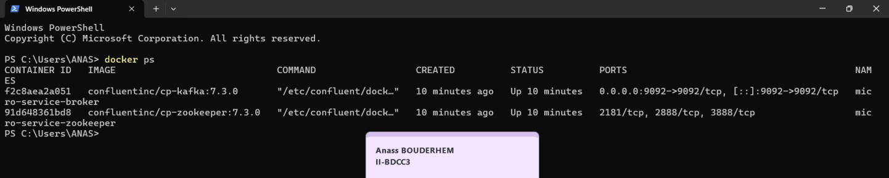
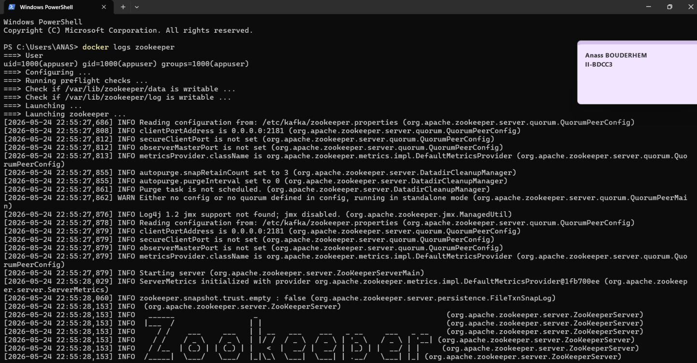
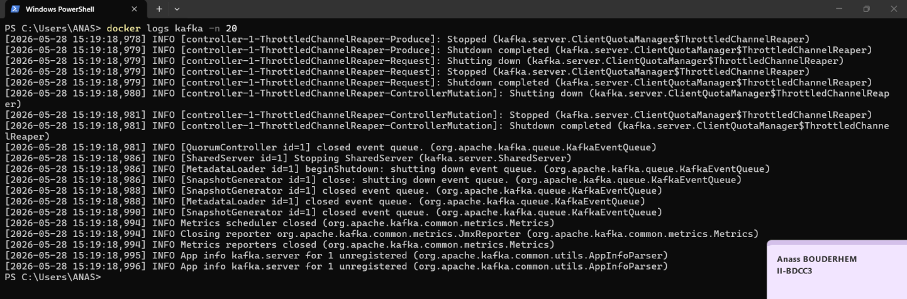
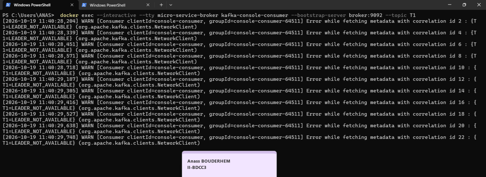
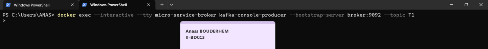
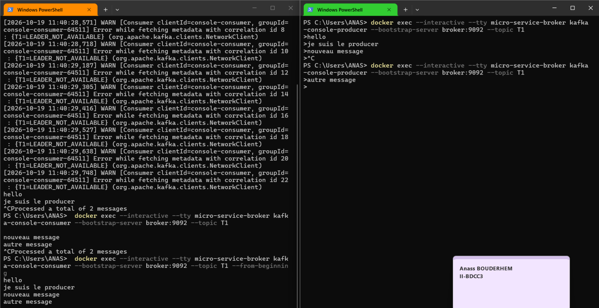

# Event Driven Architecture

## 1. Téléchargement de Kafka et ZooKeeper

Le fichier `docker-compose.yml` permet de configurer les deux services.

```yaml
version: '3'
services:
  zookeeper:
    image: confluentinc/cp-zookeeper:7.3.0
    container_name: micro-service-zookeeper
    environment:
      ZOOKEEPER_CLIENT_PORT: 2181
      ZOOKEEPER_TICK_TIME: 2000

  broker:
    image: confluentinc/cp-kafka:7.3.0
    container_name: micro-service-broker
    ports:
      - "9092:9092"
    depends_on:
      - zookeeper
    environment:
      KAFKA_BROKER_ID: 1
      KAFKA_ZOOKEEPER_CONNECT: 'zookeeper:2181'
      KAFKA_LISTENER_SECURITY_PROTOCOL_MAP: PLAINTEXT:PLAINTEXT,PLAINTEXT_INTERNAL:PLAINTEXT
      KAFKA_ADVERTISED_LISTENERS: PLAINTEXT://localhost:9092,PLAINTEXT_INTERNAL://broker:29092
      KAFKA_OFFSETS_TOPIC_REPLICATION_FACTOR: 1
      KAFKA_TRANSACTION_STATE_LOG_MIN_ISR: 1
      KAFKA_TRANSACTION_STATE_LOG_REPLICATION_FACTOR: 1
```

Téléchargement des images et démarrage des conteneurs :

```bash
docker compose up -d
```

Vérification de l'état des conteneurs :

```bash
docker compose ps
```



*Figure 1 — Démarrage des conteneurs.*

## 2. Démarrage de ZooKeeper

ZooKeeper est démarré automatiquement par Docker Compose. Il assure la coordination nécessaire au fonctionnement de cette version de Kafka.

Vérification des logs :

```bash
docker logs zookeeper
```



*Figure 2 — Vérification du démarrage de ZooKeeper.*

## 3. Démarrage du serveur Kafka

Le broker Kafka est démarré dans un conteneur Docker et se connecte à ZooKeeper.

Vérification des logs :

```bash
docker logs kafka
```



*Figure 3 — Vérification du démarrage du serveur Kafka.*

## 4. Test avec Kafka Console Producer et Consumer

### 4.1. Démarrage du consommateur

Le consommateur est lancé dans un terminal afin de recevoir les messages publiés dans le topic.

```bash
docker exec --interactive --tty micro-service-broker kafka-console-consumer --bootstrap-server broker:9092 --topic T1
```



*Figure 5 — Démarrage du consommateur Kafka.*

### 4.2. Démarrage du producteur

Dans un autre terminal, le producteur est lancé pour envoyer des messages au topic `tp-kafka`.

```bash
docker exec --interactive --tty micro-service-broker kafka-console-producer --bootstrap-server broker:9092 --topic T1
```



*Figure 6 — Envoi des messages avec le producteur Kafka.*

### 4.3. Vérification de la réception des messages

Les messages envoyés par le producteur apparaissent dans le terminal du consommateur, confirmant le bon fonctionnement de la communication entre les deux composants.



*Figure 7 — Réception des messages par le consommateur Kafka.*
